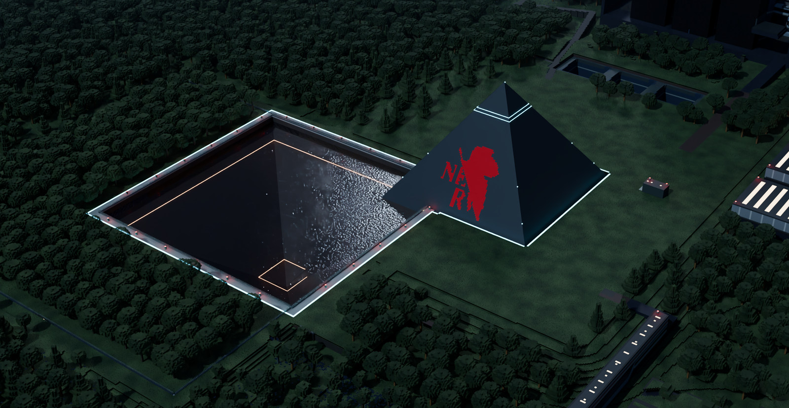

# Project SEELE: Encore

**在 Minecraft 中，从 NERV 的机库走向第三新东京市。**

一个开源、免费、非商业的《新世纪福音战士》世界观模组。驾驶 EVA，展开 A.T. Field，迎击使徒，并让整备、出击、供电和回收成为真正可操作的过程。

An open-source, non-commercial Evangelion fan mod for **Minecraft 1.20.1 / Forge 47.4.10**.

一个 EVA 粉丝和算法爱好者，献给 EVA 与自己大学生涯的一次 Encore。



*GeoFront · R53 开发世界，2026-10-18。由实际存档导出，在 Blender Cycles 中离线渲染；连续斜面、水体和摄影灯光经过宣传处理，不代表实时游戏画质或帧率。[图片来源与处理说明](docs/images/README.md)。*

[开发环境](#从源码启动) · [参与贡献](CONTRIBUTING.md) · [当前进展](#当前进展) · [完整路线图](docs/ROADMAP.md) · [素材与许可](docs/ASSETS.md)

## 可以体验什么

- **EVA 驾驶与战斗**：初号机、零号机、二号机，近战、武器、A.T. Field、同步率与初号机暴走。
- **机库到战场的机械流程**：插入栓吊装与接入、LCL 排注、转移架、发射舱门、轨道运输、发射和回库。
- **供电与后勤**：外部电源、脐带电缆、内部电池、装备领用，以及运输机接载和地上／地下转运。
- **NERV 与城市设施**：GeoFront、指挥室、第三新东京市、车站、电梯、机场和 UN 试验基地；NPC 可以操作整备与指挥设备。
- **使徒与剧情原型**：萨基尔、夏姆榭尔、拉米尔等战斗，以及后续屋岛作战和第三次冲击的开发内容。

这些系统仍在持续开发。**源码仓库与完整演示世界是不同的交付物**：公开仓库包含代码、项目原创资源和回退美术；完整本机存档及部分模型含第三方材料，未作为公开下载提供。直接构建源码不会得到宣传图中的完整地图与资源组合。详见 [公开分发边界](docs/OPEN_SOURCE_RELEASE_R24.md)。

## 当前进展

**R53 开发版 · 更新于 2026-10-19。当前进行人工试玩，尚非正式发布版。**

| 范围 | 当前状态 |
|---|---|
| 整备、插栓、发射与回库 | 本次试玩发现回库记录与真实液体／桥状态不一致；本机已有修复候选，现场验证未完成；转移供电闪烁、舱门重叠及栓内穿模仍待处理 |
| 运输机回收 | 已完成一次遮挡下牵引、姿态整理、起吊和回库闭环；更多地形和动作观感待复核 |
| 地图与设施 | 已安装近期的发射仓、天然湖、穹顶饰面和远景同步修补；全图美术不宣称全部验收 |
| 连续动作、处决、发射／弹射音画 | 已有实现与修订；本次反馈的刀击腿部、拳击翻腕与走跑不流畅仍未验收 |
| 性能与崩溃稳定性 | 已处理部分热点；专项复测安排在本次人工复核之后，崩溃原因尚未全部定论 |
| 箱根至第三新东京市的远距屋岛作战 | 保留研究与候选实现，待人工复核后继续；尚未作为完整通关内容交付 |

最近安装与原生检查见 [R53 工作记录](docs/R53_RESUMED_20261019_EVENING.zh.md)。历史阶段记录保留在 `docs/`，其中旧包名、旧坐标和旧验收结论不代表当前版本。

## 从源码启动

需要 **Git、JDK 17、Python 3.11+**。使用仓库自带的 Gradle 8.8 wrapper，无需单独安装 Gradle。

Windows PowerShell：

```powershell
git clone https://github.com/BoyangLi21/Project-Seele-Encore.git
cd Project-Seele-Encore
python tools/bootstrap_dev_dependencies_r24.py
.\gradlew.bat build
.\gradlew.bat runClient
```

Linux/macOS 使用 `python3` 和 `./gradlew`。首次构建会下载依赖并准备 Minecraft 开发环境；地图工具的跨平台支持另见 [参与指南](CONTRIBUTING.md)。

下载助手获取固定版本的公开依赖并核对校验值，保存在 `.Codex/local-mods/`。它不会下载私有地图或模型。构建产物位于 `build/libs/`；开发客户端日志位于 `run/logs/latest.log`。

| 命令 | 用途 |
|---|---|
| `gradlew build` | 编译、执行已接入的回归检查并生成模组 JAR |
| `gradlew runClient` | 启动可见的 Forge 开发客户端 |
| `gradlew runServer` | 启动开发专用服务器 |

环境配置见 [SETUP](docs/SETUP.md)。安装包需要使用同一交付批次的模组、配置和地图；旧测试包不会随源码更新而自动升级。

## 默认驾驶操作

游戏内「选项 → 控制」可以查看和修改键位。机械联锁、机体型号和当前装备会影响可用操作。

| 操作 | 默认输入 |
|---|---|
| 移动／跳跃／奔跑 | WASD / Space / Ctrl |
| 蹲姿／匍匐 | Shift / Z |
| 攻击／重击或炮蓄力 | 鼠标左键 / 鼠标右键 |
| 踢击／切换武器 | B / R |
| A.T. Field／驾驶通信 | G / O |
| 弹出插入栓 | V |
| 方向闪避／奔跑翻滚 | 方向 + C / 奔跑 + C；机械准备或发射期间 C 优先取消发射 |

零号机盾牌与二号机长剑需要在配套世界中实际领取。当前普通世界与完整 NERV 演示世界的设备布置不同，开发指令不能代替设施流程的验收。

## 仓库导航

| 位置 | 内容 |
|---|---|
| `src/main/java/com/projectseele/` | 游戏逻辑、实体、机械、网络、渲染和设施系统 |
| `src/main/resources/` | 模组注册资源、原创音效、贴图、模型与数据 |
| [src/test](src/test/) | 数学、几何、状态持久化、编解码等回归检查 |
| [tools](tools/) | 依赖准备、资产生成、地图审计和交付工具 |
| `assets-source/`、`art_sources/` | 已入库的可编辑美术来源 |
| `docs/` | 设计、来源登记、阶段记录和验证边界 |

贡献前请读 [CONTRIBUTING](CONTRIBUTING.md)。修改存档先读 [地图编辑协议](docs/MAP_EDITING_PROTOCOL.md)；动作与画面检查见 [视觉工作流](docs/VISUAL_RECOVERY.md)。构建通过不等于玩法、手感或美术验收通过。

## 许可与致谢

- 代码采用 [MIT](LICENSE)；第三方和衍生美术遵守各自许可，不能统一改标 MIT。
- 本项目为非官方、永久免费、非商业的粉丝创作，与 khara, inc. 无关联或背书，遵循 [khara 二次创作指引](https://www.khara.co.jp/guideline/)。
- 不包含官方音频、原画或影像素材。音效、模型、地图与动作的来源和修改记录见 [素材登记](docs/ASSETS.md)、[动作声明](docs/THIRD_PARTY_MOTION_NOTICES.md)。
- 当前仓库为 [Project-Seele-Encore](https://github.com/BoyangLi21/Project-Seele-Encore)，旧 Project-Seele 历史继续保留。

> God's in his heaven. All's right with the world.
