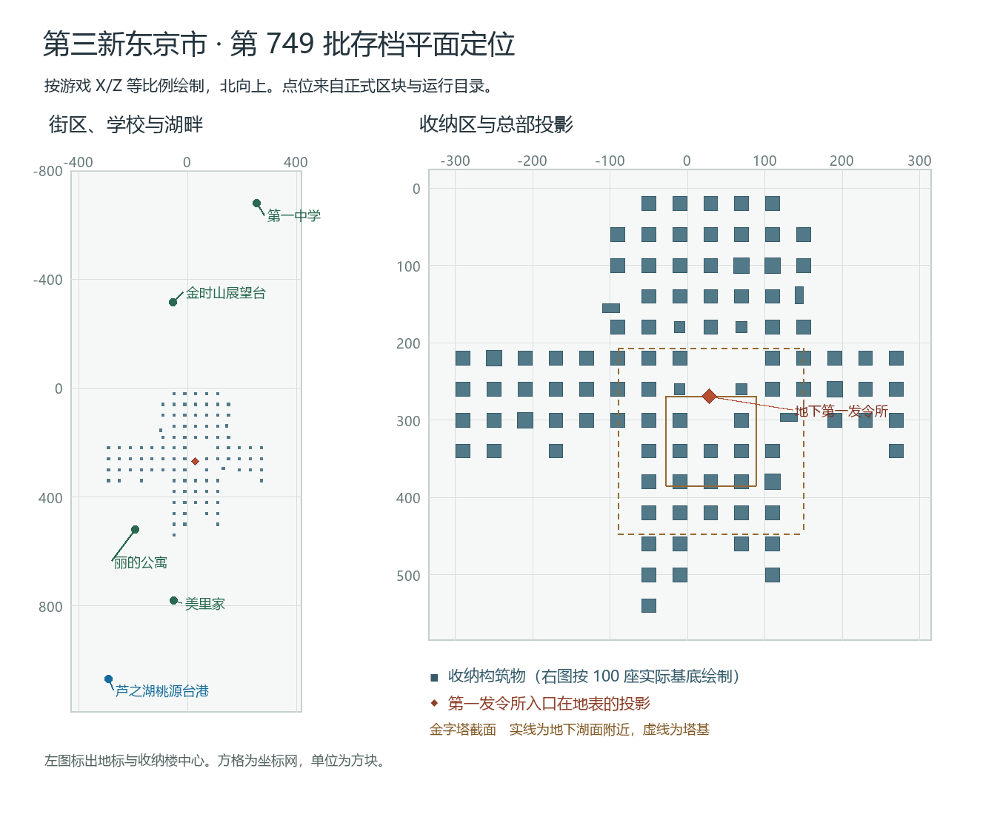

# R65 第三新东京市、地下总部与 TV 版原作对照

## 玩家能去，机体能不能去

第 22 话里零号机能到莉莉丝跟前取枪。第 24 话里，二号机突破装甲隔壁，初号机奉命沿深层路径追击。第 11 话里三台 EVA 进入水平通道，再沿竖井向上爬。这几场戏证明原作有机体尺度的深层交通，EVA 也能在合适的井壁上攀爬。动画没有给出一条从机库到封印室的逐层施工图。[第 22 话场景](https://evangelion.fandom.com/wiki/Episode%3A22) · [第 24 话台词](https://www.animanga.com/scripts/textesgb/eva24.html) · [第 11 话场景](https://www.animanga.com/scripts/textesgb/eva11.html)

| R65 的实际问题 | 当前行为 |
| --- | --- |
| 人怎样到封印室？ | 持相应权限卡乘司令部后方人员电梯，到 `(-42,-1230,253)` 的终极站。管理员命令 `/seele tp dogma` 单独传送人员到 `(31.5,-1230,273.5)`。两条路线都不运输机体。 |
| EVA 可以开到莉莉丝旁边吗？ | 已建的西侧人员通道净宽 3 格，天堂之门中缝宽 7 格；站立机体宽 17、高 60 格，卧姿宽 48、高 17 格。机库到地表有出击井。总部附近尚未核实有机体可以一路开到封印室的入口。湖区以西的地下运输大井有自己的前厅，离金字塔很远。 |
| 玩家可以拔枪吗？ | 莉莉丝没有取枪交互。第 22 话 `arael` 的完成标志或管理员 `/seele lilith spear removed` 可以隐藏枪。第 22、24 话在 R65 章节目录中均为未开放。创造栏的长枪物品与封印室实体分开取得。 |
| 能不能爬墙？ | 常规机体可以自动跨越至多 20 格的障碍。站在可翻越的台沿前按空格，动作检测 21–64 格的高差，并检查上方空间和落脚面。平直竖壁上没有连续向上爬的动作，所以原作第 11 话的井壁攀升也不是现成路线。 |

本次按第 749 批交通目录、门洞实尺、服务器输入及碰撞代码核对。没有用管理员传送充当实驾通关。游戏实现可从 [莉莉丝实体](../src/main/java/com/projectseele/entity/LilithEntity.java)、[机体尺寸](../src/main/java/com/projectseele/entity/EvaScale.java)、[攀台动作](../src/main/java/com/projectseele/entity/EvaFieldActionsR45.java)、[人员传送](../src/main/java/com/projectseele/visual/SeeleTravelCommandsR43.java) 和 [章节开放状态](../src/main/java/com/projectseele/world/TvCampaignCatalog.java) 复核。

## 地表街区与地下金字塔怎样叠在一起

100 座收纳构筑物的楼心分布在 X−290 至 270、Z20 至 540 的十字形街区。这个范围只描述会收纳的楼。地下金字塔轴心在 X30、Z327，正落在两条街区轴线交会处偏南。金字塔底层宽 241 格，地下湖面高度附近的外露截面宽 117 格。图中这两个范围分别来自对应高度的实际面板。TV 第 2、3 话确立了地表升城、楼体收进空洞穹顶的关系；十字形路网、100 座的数量和地块顺序属于本地图的安排。[第 2 话场景](https://www.animanga.com/scripts/textesgb/eva2.html) · [第 3 话场景](https://www.animanga.com/scripts/textesgb/eva3.html)

| 从城市哪里看 | 第 749 批实际能找到什么 | 与原作还有多远 |
| --- | --- | --- |
| 山上看升城 | 金时山展望台有地板、牌面和朝南的望远镜 `(-54,145,-316)`。100 座构筑物在升城街面和降城收纳位置都有实测方块。 | 第 2 话明确美里带真嗣从高处看城市升起。TV 当场没有给出游戏中的山名、坐标或每栋楼的编号。 |
| 堡垒城市的街头 | 升城时的 38 块街角牌写有「避難所 / SHELTER」，降城时相同位置的牌面随街具撤回。运行表实际登记 4 个兵装出舱站。 | 逐亭检查牌下 Y75–80 的中心线时绝大多数是实体，未见向下的楼梯或梯子。现在有避难入口的形象，尚未核实从学校或住宅进入有容量、分区和出口的地下避难所。兵装楼的外观数量也不能当作可用出舱点的数量。[第 3 话避难及转入战斗配置场景](https://www.animanga.com/scripts/textesgb/eva3.html) |
| 学校、住宅和湖畔 | 第一中学在核心区以北，校门牌 `(254,74,-680)`，校舍有座椅、书架及体育馆。丽的 402 室 `(-193,104,519)` 在收纳区西南侧，美里家的 11-A-2 `(-50,164,779)` 更靠南。再往西南可到桃源台港 `(-291,102,1068)`，芦之湖水面 Y99。GeoFront 港口水面在地下 Y−473，两湖不同。 | 箱根仙石原、芦之湖与大涌谷提供地理参照。官方联动资料支持仙石原附近这一地理锚点。它没有给出 TV 城市逐街的总平面图，学校和公寓在游戏中的精确方位仍属于项目布局。[箱根授权联动说明](https://www.hakone-ryokan.or.jp/blog/255.html) |
| 轨道交通 | 正式 MTR 数据登记 66 站、114 个站台、21 条路线。螺旋线通往外壁、倒挂城市及地表，港口站能换步行栈桥。 | 第 1 话的人员入部交通和 EVA 出击机构用途不同。现版可以走通自己的通勤网络；螺旋线、住宅区和地下军港属于扩建。[第 1 话场景](https://www.animanga.com/scripts/textesgb/eva1.html) |
| 城市遭破坏后 | 升城和降城两份交付存档都保留城市、湖岸、民居和车站。日常收纳是可逆状态。 | TV 第 23 话之后的毁城、旧剧场版《Air》中地表遭攻击、GeoFront 暴露，是另一些时间点的场景。这次没有找到能复访这些场面的独立世界状态。地图中既有空地和湖岸也不足以指认这些事件。[第 23 话](https://www.b-ch.com/titles/466/023) · [官方作品介绍](https://www.eva-info.jp/works) |

目前可以从学校、民居和湖港定位日常城市，也可以从山坡看核心区升降。兵装建筑中，A1 有四座可用站，A2、A3 各四座主要表现导弹楼和供电楼的外观。游戏里的街区配列可据存档逐栋重画；要判断是否与某幅原画的轮廓及遮挡吻合，需要以那幅画的镜头和场景时间为基准。新潟县立近代美术馆年报列有 1995 年的第一发令所、街块与天井都市设定图，可以追溯原始美术资料。[原画展品目录，第 69 页](https://kinbi.pref.niigata.lg.jp/pdf/nenpo/an2022.pdf#page=69) · [金时山与城市升降的授权展区](https://smallworlds.jp/area/eva_tokyo/)

## 丽的房间、复制槽和 Dummy 装置在哪里

第 23 话里，律子带真嗣和美里先到丽出生、小时候生活过的地下房间，再经过废弃 EVA 骨骸，最后让他们看见水槽中的丽。出生房间、墓场、复制槽是三个可辨认的场景。该段给了参观顺序，没有交代三个门牌楼层，也没有给出通往莉莉丝房间的平面图。从这个场景可以还原一条受控参观路线；若为游戏分配层号，应标作本项目设计。[第 23 话台词](https://ssl.animanga.com/scripts/textesgb/eva23.html) · [第 23 话导演剪辑版分镜与画面](https://www.avians.net/rkc/14daughters/scripts/episode-23/episode-23_%2Britsuko.html)

“Dummy 大脑层”所指的画面里，有脑状装置、脊柱状连接、供丽进入的竖直液槽，以及容纳许多丽的设施。这些是 Dummy Plug Plant 的视觉要素。第 17 话还说明，试制插入栓记录了丽的人格特征，灵魂则无法复制。片中并未把脑状部件确认为另一栋楼或更深一层；从复原角度，可把观察水槽、竖槽和设备区设计成在同一受控设施内可辨认的几个空间。资料索引给出的名称包括“地下深层设施・中央部”，具体该归 Central 还是 Terminal 的哪一层，项目应保留不确定性。[第 17 话台词](https://secure.animanga.com/scripts/textesgb/eva17.html) · [Dummy Plug Plant 场景索引及其推测说明](https://wiki.evageeks.org/Dummy_Plug_Plant)

第 13 话的普里布诺箱（Pribnow Box）用于模拟体和插入栓试验，MAGI 负责计算与管理。第 23 话的复制槽服务于另一项实验。游戏里可以用不同的器械、房间入口和标识把这两段剧情讲清楚。[第 13 话台词](https://www.animanga.com/scripts/textesgb/eva13.html) · [第 23 话台词](https://ssl.animanga.com/scripts/textesgb/eva23.html)

天堂之门、红十字架、被钉住双手的白色巨人和下方的 LCL 湖是最深封印室的定位标志。第 24 话和旧剧场版都把这处空间直接与莉莉丝联系起来。紫色面具的七只眼沿两列排列，面具有倒三角刻痕；朗基努斯枪的状态随剧情改变。TV 版和 1997 年旧剧场版作为本项目复原基准。《新剧场版：破》把另一套 Dummy System 的运抵与 Golgotha Base 联系起来，不能据此给 TV 本部增设同名楼层。[莉莉丝画面与设定索引](https://wiki.evageeks.org/Lilith) · [旧剧场版终章场景记录](https://www.evaotaku.com/html/sincerely.html) · [《破》关于设备运抵的对白](https://www.springfieldspringfield.co.uk/movie_script.php?movie=evangelion-2-0-you-can-not-advance)

第 22 话导演剪辑版补画了零号机拔枪后莉莉丝下半身再生的镜头。到旧剧场版，丽与莉莉丝融合后才出现巨大的丽形态。R65 保留 Kiki 原模型，既有剧情标志只控制长枪是否显示。[第 22 话版本差异](https://evangelion.fandom.com/wiki/Episode%3A22) · [旧剧场版融合场景](https://www.evaotaku.com/html/sincerely.html)

## 正式世界第 749 批的可见内容

本次对照读取正式存档的交通目录、总部框架、人员电梯楼层清单、莉莉丝实体和实际方块。另在总部及深层主体周围（区块 X −14 至 18、Z −20 至 37、Y 低于 −370 的已扫描区域）查得 85 种非空牌面文字。下表中的“未定位”表示在这些证据及项目设施实现里还没有找出对应的可参观房间。未命名的小房间仍可能有相似陈设。

| 原作场所 | 现版定位及差异 |
| --- | --- |
| GeoFront、总部金字塔、倒挂城市 | 穹顶、森林、天然湖、中央金字塔与倒挂楼体均已建成。螺旋线、具名住宅、员工宿舍、地下港口及两艘舰艇属于游戏扩建。 |
| 第一发令所、MAGI | 指挥室入口在 (28.5, −499, 269.5)，附近有冬月、美里、律子、日向、青叶和伊吹的实体。三座红色机壳各有 12 块红色下半砖，西、中两座的门牌可读出 MELCHIOR-1 和 BALTHASAR-2。东壳在 (34, −513, 287) 附近，按三机排列可推为 CASPER-3，现场未读到这个名字的牌面。 |
| 备用指挥与撤离 | 第 20 话里，律子启用与第一发令所布局相同的第二发令所，当天上午先在没有 MAGI 支持的情况下指挥。第 19 话另有把伤员等人转移到第三中心的命令。现版可到第一发令所、SEELE 会议室和倒挂城市作战基地，交通目录和总部牌面尚未定位到第 20 话的备用发令所。[第 20 话台词](https://www.animanga.com/scripts/textesgb/eva20.html) · [第 19 话台词](https://ssl.animanga.com/scripts/textesgb/eva19.html) |
| 装甲层和主轴 | 第 19 话明确把最后一层装甲熔穿与主轴暴露关联起来。正式世界旧施工表在 (30, 355) 周围记有八层上壳。在原表的 7×7 占地逐格读取，第八层 245 格均为结构板，第七层 63 格为结构板，第一至六层现为岩体、空腔或道路材料。地下运输大井可由交通目录进入。从这里沿主轴到达发令所主屏、机库和终极教条的连续布局仍待现场确认。[第 19 话台词](https://ssl.animanga.com/scripts/textesgb/eva19.html) |
| 总司令办公室、会议室、医疗区 | 总指挥专梯有联络厅、SEELE 会议室及会客厅。医疗支援室实牌在 (−28, −524, 373)。医疗区现有房间与丽出生时的地下房间用途不同。 |
| 医疗翼与丽的居所 | 101–103 三间独立病房的床头可分别在 (−42, −527, 401)、(−28, −527, 401)、(−14, −527, 401) 找到。地表旅行目录另列“绫波丽公寓门外”。两处都不能充当第 23 话带真嗣参观的地下旧房间。[第 23 话台词](https://ssl.animanga.com/scripts/textesgb/eva23.html) |
| EVA 机库、登机、发射设施 | 三个机笼在 Y−1062、Z328.5，零号、初号和二号分别位于 X72.5、30.5 和 −11.5。人员电梯在 (58, −1014, 366) 停靠登机平台。机库有插入栓、移送机构与多个发射出口。TV 第 19 话表现的主屏、机库与五号弹射口之间的近距离连接，现版尚未核实。项目曾依照自己的交通需求调整机库位置。[第 19 话镜头](https://wiki.evageeks.org/FGC:Episode_19_Scene_09) |
| 同步实验和普里布诺箱 | 电梯可到 (89, −1088, 366) 的 LCL 同步实验层。现有旧模板以紫水晶中心及遮光玻璃标识实验箱。扫描总部深部 1,914 个地形区块，未找到该模板的紫水晶标记。仍未定位到完整呈现 TV 第 13 话模拟体、隔离区与观察控制室的实验区。不同材料搭成的小房间不在这个判据内。[第 13 话台词](https://www.animanga.com/scripts/textesgb/eva13.html) |
| 天堂之门、莉莉丝、LCL 湖 | 前室电梯在 (−42, −1230, 253)，门牌在 (30, −1199, 257)。世界中有独立莉莉丝实体，锚点 (30.5, −1264, 348.5)，双手与十字横梁同高；湖面 Y=−1265。门前导线、湖床与照明在第 747 批调整。项目楼层高度是游戏尺度。 |
| 丽的出生房间 | 未定位到有第 23 话对应陈设、可从实验路线进入且能独立辨认的房间。 |
| 废弃 EVA 墓场 | 未定位到与该段剧情对应的成片实验体骨骸、废弃井和观察通路。 |
| 复制体槽和 Dummy 核心设备 | 未定位到环形储槽、成列的备用身体，以及联接的脑状设备和竖槽。现有 LCL 实验层与站牌提供可用的交通入口。 |

若要补第 23 话，最直接的顺序是从现有科研联络层引入一段受限通路，先经过旧房间，再到墓场，最后打开复制槽的观察面。莉莉丝继续由天堂之门进入。这一连法属于地图设计；具体深度、步行距离与两条路线的连接点可按存档空间确定。

现场依据可在存档内的 `r52/travel.json`、`personnel_lifts_r52.json`、`spatial_contract_r21.json` 与 GeoFront 维度区块交叉检查。复核时最好从人员电梯实际抵达楼层，尤其避免引用总部下移前的旧地图坐标。
